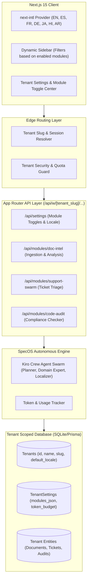

# System Design Specification: SpecOS

## 1. High-Level Architecture

SpecOS employs a modular monolith architecture with strict row-level tenancy, edge middleware routing, and dynamic module loading.



## 2. Database Schema (Prisma/SQLite)

```prisma
datasource db {
  provider = "sqlite"
  url      = "file:./dev.db"
}

generator client {
  provider = "prisma-client-js"
}

model Tenant {
  id            String         @id @default(cuid())
  name          String
  slug          String         @unique
  defaultLocale String         @default("en")
  createdAt     DateTime       @default(now())
  updatedAt     DateTime       @updatedAt
  settings      TenantSettings?
  users         Membership[]
  documents     TenantDocument[]
  tickets       SupportTicket[]
  audits        CodeAudit[]
  usageLogs     UsageLog[]
}

model TenantSettings {
  id                 String   @id @default(cuid())
  tenantId           String   @unique
  tenant             Tenant   @relation(fields: [tenantId], references: [id], onDelete: Cascade)
  enabledModules     String   // Stored as JSON: { docIntel: boolean, supportSwarm: boolean, codeAudit: boolean }
  tokenBudgetMonthly Int      @default(100000)
  tokensConsumed     Int      @default(0)
  customBranding     String?  // JSON { primaryColor, logoUrl, companyTagline }
  updatedAt          DateTime @updatedAt
}

model User {
  id          String       @id @default(cuid())
  email       String       @unique
  name        String
  preferredLocale String   @default("en")
  memberships Membership[]
  createdAt   DateTime     @default(now())
}

model Membership {
  id        String   @id @default(cuid())
  userId    String
  tenantId  String
  role      String   @default("MEMBER") // OWNER, ADMIN, MEMBER, VIEWER
  user      User     @relation(fields: [userId], references: [id], onDelete: Cascade)
  tenant    Tenant   @relation(fields: [tenantId], references: [id], onDelete: Cascade)

  @@unique([userId, tenantId])
}

model TenantDocument {
  id          String   @id @default(cuid())
  tenantId    String
  title       String
  content     String
  sourceLang  String   @default("auto")
  summary     String?
  riskLevel   String?  // LOW, MEDIUM, HIGH, CRITICAL
  extractedData String? // JSON metadata
  tenant      Tenant   @relation(fields: [tenantId], references: [id], onDelete: Cascade)
  createdAt   DateTime @default(now())
}

model SupportTicket {
  id          String   @id @default(cuid())
  tenantId    String
  customerEmail String
  subject     String
  message     String
  inputLang   String   @default("en")
  sentiment   String?  // POSITIVE, NEUTRAL, URGENT, NEGATIVE
  draftReply  String?
  status      String   @default("OPEN") // OPEN, IN_REVIEW, RESOLVED
  tenant      Tenant   @relation(fields: [tenantId], references: [id], onDelete: Cascade)
  createdAt   DateTime @default(now())
}

model CodeAudit {
  id          String   @id @default(cuid())
  tenantId    String
  repoName    String
  targetBranch String  @default("main")
  findings    String   // JSON array of compliance violations & fixes
  score       Int      // 0 - 100
  status      String   @default("COMPLETED")
  tenant      Tenant   @relation(fields: [tenantId], references: [id], onDelete: Cascade)
  createdAt   DateTime @default(now())
}

model UsageLog {
  id          String   @id @default(cuid())
  tenantId    String
  moduleName  String
  tokensUsed  Int
  latencyMs   Int
  tenant      Tenant   @relation(fields: [tenantId], references: [id], onDelete: Cascade)
  timestamp   DateTime @default(now())
}
```

## 3. Modular Feature Gate Architecture
Every UI component, route handler, and agent runner calls `assertModuleEnabled(tenantId, moduleKey)`.
If a module is toggled off:
- Sidebar filters out the navigation route.
- Direct API calls reject with `403 Module Disabled for this Tenant`.
- Zero unnecessary tokens or compute are expended.

## 4. Multilingual Localized Agent Pipeline
1. Client requests include the resolved locale header (`Accept-Language` or tenant default).
2. The agent orchestration layer wraps system prompts with the Localization Directive:
   ```markdown
   [SYSTEM INSTRUCTION: LOCALIZATION]
   The active tenant operates in {locale_name} ({locale_code}).
   You MUST formulate all executive summaries, advice, risk ratings, and replies in {locale_name}.
   Ensure professional terminology appropriate to the domain.
   ```
3. Responses stream back in the localized tongue with formatted markdown.
